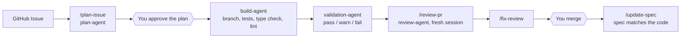

# agent-kit

Personal AI tooling hub for coding agents across Rafael Melon's projects.

## What This Is

A portable tooling layer, not a deployable app. The neutral source of truth is
plain Markdown (`AGENTS.md`, `SPEC.md`, `docs/`), with adapters for tools that
support native rule or command formats.

It provides:

- **Slash commands**: `/plan-issue`, `/review-pr`, `/fix-review`, `/update-spec`, `/handoff`
- **Tooling skills**: GitHub, Vercel, Supabase, browser automation
- **Agent roles**: PM, Plan, Build, Review, Spec Divergence
- **Canonical rules**: shared conventions applied across projects
- **Adapters**: Codex, Cursor, and Claude Code today; more can be added later

Project knowledge (specs, docs, architecture decisions) lives in each project
repo.

## How it works

An idea becomes a merged, documented change through small steps. Agents do the
typing, and a human signs off the three decisions that matter: the plan, risky
changes such as migrations, and the merge.



An example session (illustrative, with a made-up project):

```text
you    > create issue #42: "Add a watchlist to the movie app"
you    > /plan-issue 42
agent  > Minimal plan: 1 migration, 1 API route, 1 component.
         One test per acceptance criterion (AC-MOVIE-001..003). Posted on #42.
you    > Approved.
agent  > Branch feat/movie-add-watchlist. 3 commits. tsc, lint, tests: green.
         validation-agent: pass, 1 warning (no index on watchlist.user_id).
you    > (new session) /review-pr 57
agent  > 1 blocking finding, verified by trying to refute it. 2 suggestions.
you    > /fix-review 57
you    > merge
you    > /update-spec
```

## What it is not

- **Not an app or a framework.** There is nothing to run or deploy: it is
  Markdown, a few hooks and some config that agents read.
- **Not an autonomous agent.** It automates the typing, not the decisions. The
  plan, risky migrations and every merge need a human.
- **Not tied to one tool.** `AGENTS.md`, `SPEC.md` and `docs/` are plain
  Markdown. Claude Code, Cursor and Codex adapters are thin translations of the
  same workflow.
- **Not memory in the chat.** State lives in the repo: the spec in files, the
  plan in the issue, the progress in the git branch, and the next step in
  `.agent/handoff.md`. Any tool can pick up where another stopped.
- **Not neutral about stack.** `SPEC.md` is opinionated (Next.js, Supabase,
  Vercel). Fork it and change the rules to fit your own projects.
- **Not a replacement for review.** The review agent works in a fresh session
  and has to verify each blocking finding, but a human still reads the PR.

## Session handoff

Each project keeps `.agent/handoff.md`: what is true now, what comes next, what
was decided, and what was tried and rejected (with one line of why). A new
session, in any tool, starts from it instead of from a chat that is gone. It is
local and never committed, so it can hold private details. Chat is disposable;
the repo holds the spec and plan, the branch holds the what, and this file holds
the why. Limits are listed in [docs/workflow.md](docs/workflow.md#session-continuity).

## Setup

### 0. Environment Variables

Copy `.env.example` to `.env.local` and fill in your tokens:

```bash
cp .env.example .env.local
```

Then register the Supabase token with the agents you use.

Claude Code example:

```bash
claude mcp add supabase --env SUPABASE_ACCESS_TOKEN=<your-token>
```

Cursor and Codex can use MCP config files or their own connector settings. See
`docs/cursor.md` and `docs/codex.md`.

Tokens needed:
- **Supabase PAT**: supabase.com -> Account -> Access Tokens
- **GitHub token**: github.com -> Settings -> Developer settings -> Personal
  access tokens (scopes: `repo`, `read:org`)

## Quick start

### 1. Add To Workspace

```json
// rafaelmelon.code-workspace
{
  "folders": [
    { "path": "agent-kit" },
    { "path": "movie-recommender" }
  ]
}
```

Any agent can read `AGENTS.md`, `SPEC.md`, and `docs/workflow.md` as the
neutral contract.

### 2. Tool Adapters

- **Codex**: use `AGENTS.md` as the primary contract. See `docs/codex.md`.
- **Cursor**: use `.cursor/rules`, `.cursor/commands`, and `.cursor/mcp.json`.
  See `docs/cursor.md`.
- **Claude Code**: install as a plugin and load `SPEC.md` globally. See
  [docs/claude-code.md](docs/claude-code.md).

### 3. Workflow

```text
GitHub Issue -> /plan-issue <number> -> build -> validation-agent
  -> PR -> /review-pr <number> (fresh session) -> /fix-review <number>
  -> /update-spec
```

See [docs/workflow.md](docs/workflow.md) for the full guide.

## Structure

```text
agent-kit/
├── AGENTS.md               # Provider-neutral agent instructions
├── SPEC.md                 # Canonical rules (R1-R11)
├── CLAUDE.md               # Claude Code compatibility shim
├── CONTRIBUTING.md         # Conventions for this repo
├── .mcp.json               # Shared MCP config
├── .claude-plugin/
│   ├── plugin.json         # Claude Code plugin manifest
│   └── marketplace.json    # Lets /plugin install it from this repo
├── hooks/
│   ├── hooks.json          # Plugin hooks
│   ├── block-env-access.mjs  # Hook entry: keeps agents away from .env
│   ├── env-guard.mjs       # Guard logic (tested in env-guard.test.mjs)
│   ├── load-handoff.mjs    # Hook entry: starts each session from .agent/handoff.md
│   └── handoff.mjs         # Handoff logic (tested in handoff.test.mjs)
├── .cursor/
│   ├── commands/           # Cursor custom commands
│   ├── rules/              # Cursor project rules
│   └── mcp.json            # Cursor MCP config
├── .claude/
│   ├── commands/
│   │   ├── plan-issue.md   # Plan from a GitHub Issue
│   │   ├── update-spec.md  # Sync project spec after a feature
│   │   ├── review-pr.md    # Review a PR, verifying findings
│   │   └── fix-review.md   # Close one review round
│   ├── skills/
│   │   ├── github/         # GitHub Issues, PRs, Actions
│   │   ├── vercel/         # Deploy, logs, env vars
│   │   ├── supabase/       # Database, migrations, RLS, auth
│   │   ├── browser-automation/  # Playwright
│   │   └── test-rules/     # Which test, at which layer
│   └── agents/
│       ├── pm-agent.md
│       ├── plan-agent.md
│       ├── build-agent.md
│       ├── validation-agent.md
│       ├── review-agent.md
│       ├── spec-divergence-agent.md
│       └── design-to-code-agent.md
└── docs/
    ├── adapters.md
    ├── claude-code.md
    ├── codex.md
    ├── cursor.md
    └── workflow.md
```

## Adding new tooling

| What | Where |
|------|-------|
| New neutral rule | `SPEC.md` |
| New neutral workflow | `docs/workflow.md` |
| New Codex instruction | `AGENTS.md` or `docs/codex.md` |
| New Cursor command | `.cursor/commands/<name>.md` |
| New Cursor rule | `.cursor/rules/<name>.mdc` |
| New Claude command | `.claude/commands/<name>.md` |
| New Claude skill | `.claude/skills/<name>/SKILL.md` |
| New Claude agent | `.claude/agents/<name>.md` + entry in `.claude-plugin/plugin.json` |

Keep adapter files thin. The workflow should remain understandable to an AI
agent that only reads Markdown.
